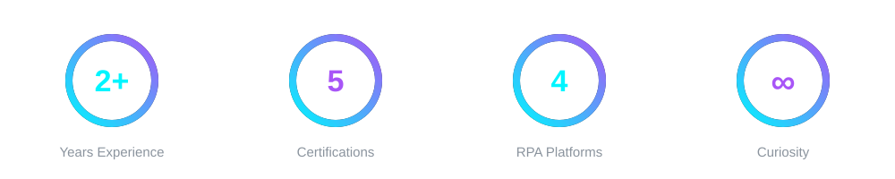
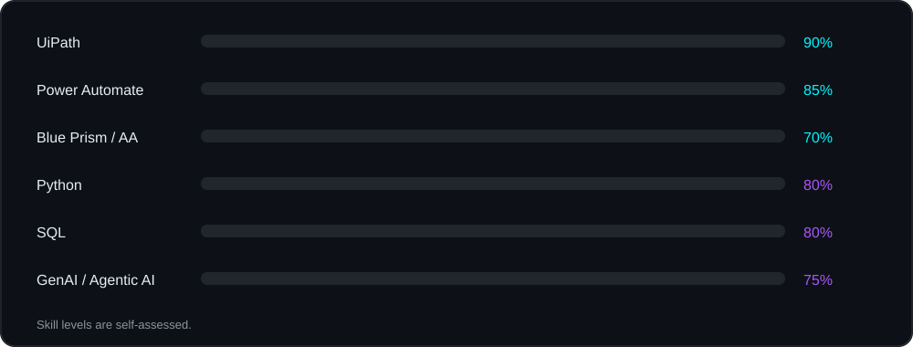

 

## 💻 Quick Intro

## 📈 At a Glance

## 👩‍💻 About Me

- 🤖 RPA Analyst with **2+ years** of hands-on experience building intelligent automation
- 🏅 **UiPath Automation Developer Associate (ADA)** & **Agentic Automation Associate** certified
- ⚙️ Experienced in **UiPath (Cloud & On-Prem), Power Automate (Desktop & Cloud), Blue Prism, Automation Anywhere**
- 🧠 Exploring **GenAI, LLM integration, prompt engineering & agentic workflow orchestration**
- 🐍 Python developer with frontend experience and strong **SQL** skills
- 🎓 MCA – University of Mumbai
- 🌱 Always learning, always automating

 

## 🛠️ Tech Stack

 

## 🏆 Certifications

## 🛣️ My Journey

## 📫 Let's Connect

I'm open to collaborating on **automation, GenAI and agentic AI** projects!

